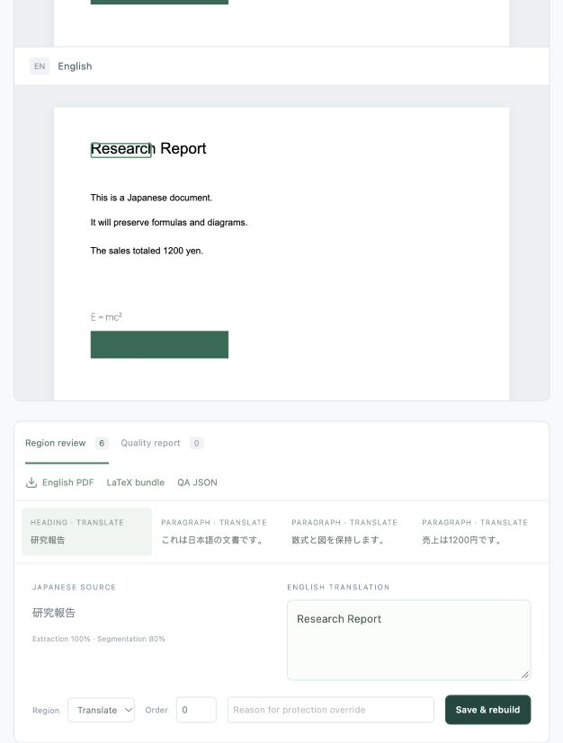

# KizunaPDF

Japanese → English PDF translation that runs on your Mac, with editable XeLaTeX output.

KizunaPDF preserves native PDF artwork, translates Japanese with a local TranslateGemma
4B model on Apple Silicon, and reconstructs selectable English using real XeLaTeX. A
local browser workspace lets you compare pages, edit regions, rebuild, and export a PDF,
LaTeX project and machine-readable quality report.

**Phase 1 / early implementation.** Native PDFs are the primary path. Scans are guarded
and experimental. Complex layouts, OCR and translation meaning still need human review.
Automated QA never promises pixel-perfect translation. See the
[tested status and limitations](docs/IMPLEMENTATION_STATUS.md).

## Start

```sh
./scripts/setup_mac.sh
uv run kizunapdf model download  # explicit Gemma Terms acceptance, ~2.2 GB
./scripts/start.command
```

Open [the local workspace](http://127.0.0.1:8787). Requires Apple Silicon macOS, Python
3.12, Node/pnpm, Apple CLT and XeLaTeX. No Docker or cloud API key. Initial dependencies
and model download need networking; document processing is local. The provided checkout
has already been configured; `./scripts/start.command` is sufficient there.

[Full setup and daily use](docs/SETUP_AND_RUN.md) · [Model setup](docs/MODEL_SETUP.md) ·
[Troubleshooting](docs/TROUBLESHOOTING.md)

## Review workspace



## CLI

```sh
uv run kizunapdf doctor
uv run python examples/synthetic_fixtures_generator.py
uv run kizunapdf translate ./tests/fixtures/generated/native.pdf --output-dir ./out
uv run kizunapdf validate ./out/native.en.pdf --manifest ./out/manifest.json
uv run kizunapdf rebuild ./out/native.kizunapdf.zip --output ./rebuilt.pdf
uv run kizunapdf serve --host 127.0.0.1 --port 8787
```

Exit 0 means mechanical QA passed, 2 means review required, 1 means failure. A failed
hard gate prevents a current PDF export. The editable bundle contains sanitized page
backgrounds and source/target text; it is private, and not a security-redaction product.

## Development

```sh
uv sync --extra mlx
uv run ruff check src tests examples scripts
uv run pytest
pnpm --dir frontend install --frozen-lockfile
pnpm --dir frontend build
```

The deterministic translator is confined to tests. Real local model tests are explicit
scripts and never run or download weights in public CI.

[Architecture](docs/ARCHITECTURE.md) · [Quality](docs/QUALITY.md) ·
[Privacy](docs/SECURITY_PRIVACY.md) · [IR schema](docs/IR_SCHEMA.md) ·
[Design decisions and references](docs/DECISIONS.md) · [Roadmap](docs/ROADMAP.md)

Application: **AGPL-3.0-only**, chosen for PyMuPDF compatibility. Model weights retain
separate Gemma Terms and are never included in this repository. See
[LICENSE](LICENSE), [licensing](docs/LICENSING.md), and
[third-party notices](THIRD_PARTY_NOTICES.md). Design is informed by BabelDOC and
PDFMathTranslate; no scientific-novelty or comparative-quality claim is made.
