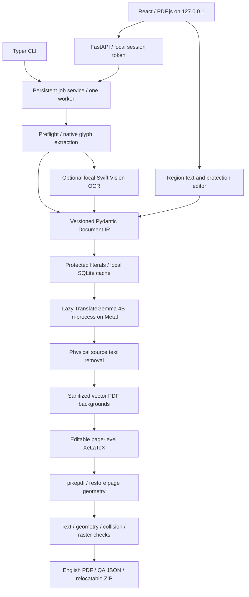

# Architecture

`core/models.py` is the shared contract. `geometry.py` owns conversions. `extract.py`
keeps glyph rectangles, source spans, style, page boxes and table cells. Tables remain
independent units; ordinary adjacent lines in a PDF block are grouped. Column order is
heuristic and may require correction. Mixed inline style is recorded but the English
overlay currently uses the dominant block style; this limitation is not a full rich-text
reconstruction claim.

`providers/mlx_translategemma.py` resolves a local model directory, validates the actual
chat template, installs the observed turn stop token, splits at Japanese sentence
boundaries using tokenizer counts, and uses greedy streaming. Sentences that cannot fit
are rejected for manual segmentation. The default safe wrapper+input budget is 1,800
and output cap is 1,024 tokens. A capped generation is never accepted. Cancellation and
180-second elapsed limits are checked at generated-token boundaries. A GPU kernel or
initial model load cannot be interrupted mid-operation.

`redaction.py` uses glyph inset rectangles, detects overlap with protected text, removes
text while preserving image and line-art objects, and verifies protected/source text.
Annotations and hyperlinks are not reconstructed; detected source annotations/links
require review. Redaction is not a general-purpose secure sanitization product.

`latex.py` makes one standalone source per page and records measured block heights.
Generated strings are escaped. Compilation runs without shell escape, in an isolated
job directory, with a 90-second timeout. Page-level PDFs merge in source order.
An output is released only after structural/text QA has no failed checks.

`jobs.py` atomically persists status and IR between translations. The API queue has one
worker and a maximum of eight queued/active jobs. Stale jobs become `interrupted` after
restart; completed segments can be reused. The CLI uses the same service synchronously.
Run only one application process for a given data directory. Separate CLI processes
are not coordinated by a cross-process model lock in this release.

`completed` means automated QA passed, not that a human certified translation meaning.
`needs_review` may have a downloadable draft if no hard gate failed. A compile, missing
text, geometry, unsafe removal, model or overflow failure has no current downloadable
PDF. Edits invalidate old exports until rebuild succeeds. Original PDFs remain private.
